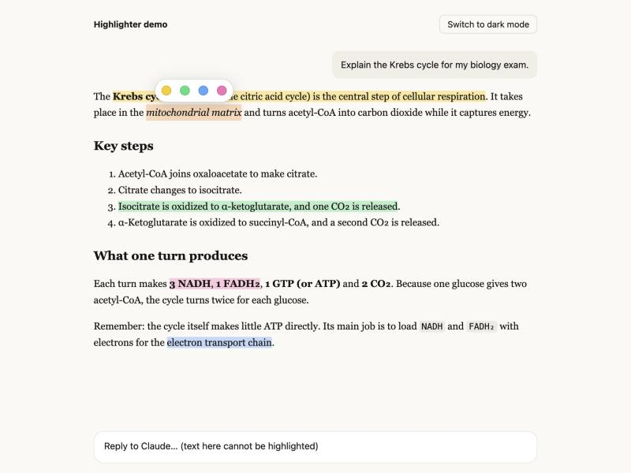
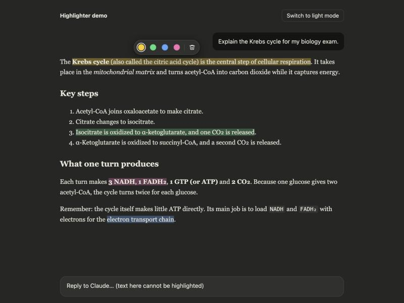
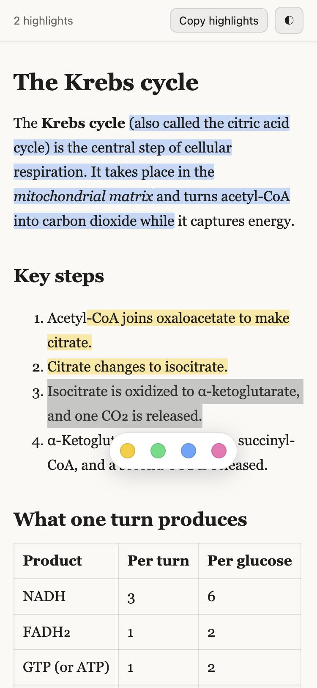

# Claude Highlighter

Highlight Claude's answers, like a highlighter pen on paper.

Made for studying: read Claude's answer, mark the important parts, and come back to them later.

## Two parts: pick the one for your app

| You use Claude in… | Install | Where you highlight |
| --- | --- | --- |
| A browser (claude.ai in Chrome, Edge, Brave, Arc) | [Browser extension](#browser-extension) | Directly in the chat |
| The desktop app, the phone app, or any browser | [Study skill](#study-skill-web-desktop-and-mobile) | In a study page that Claude opens next to the chat |

You can use both.

---

## Browser extension

| Light mode | Dark mode |
| --- | --- |
|  |  |

### How to use

1. Select text in a chat.
2. Click a color.

To change or remove a highlight, click it.

| Action | How |
| --- | --- |
| Highlight | Select text, then click a color |
| Quick highlight | Select text, then press `Alt`+`H` (`⌥`+`H` on Mac). It uses your last color. |
| Change the color | Click the highlight, then click a new color |
| Remove | Click the highlight, then click the trash icon |
| Copy all highlights as notes | Click the extension icon, then **Copy all highlights** |

### Install

Works in Chrome, Edge, Brave, Arc and other Chromium browsers (version 105 or later).

1. Download [**claude-highlighter-extension.zip**](https://github.com/bajaj-keshav/claude-highlighter/releases/latest/download/claude-highlighter-extension.zip), then unzip it.
2. Open `chrome://extensions` in your browser.
3. Turn on **Developer mode** (top-right corner).
4. Click **Load unpacked**.
5. Select the unzipped `claude-highlighter-extension` folder.
6. Open [claude.ai](https://claude.ai). If a chat was already open, reload the tab.

Tip: pin the extension (puzzle icon → pin) to see the highlight count and the copy button.

### Features

- **Four colors:** yellow, green, blue and pink.
- **Light and dark mode:** colors change automatically with Claude's theme. Text stays easy to read in both.
- **Saved:** highlights stay after you reload the page or come back to the chat later.
- **Whole words:** if you select half of a word, the highlight grows to the full word.
- **No overlap mess:** a new highlight that touches an old one joins it.
- **Safe:** the extension does not change Claude's page structure. It uses the browser's [CSS Custom Highlight API](https://developer.mozilla.org/en-US/docs/Web/API/CSS_Custom_Highlight_API).
- **Private:** it asks only for the `storage` permission, runs only on `claude.ai`, and sends nothing over the network.

### Limits

- Browser only. The Claude desktop and phone apps cannot run extensions. Use the [study skill](#study-skill-web-desktop-and-mobile) there.
- It does not work inside artifacts. Artifacts run in a separate frame.
- If you edit a message or Claude writes a new answer, highlights on the old text can disappear.
- Highlights stay in one browser. They do not sync between computers.

---

## Study skill (web, desktop and mobile)

A Claude skill that puts Claude's answer into a study page with a built-in highlighter. The study page is an artifact: the panel that Claude opens next to the chat (full screen on a phone).



### How to use

1. In any Claude app, ask your question and add **"/study"** or **"make it highlightable"**.
   Example: `Explain the Krebs cycle for my exam /study`
2. Claude opens the answer as a study page.
3. Select text, then tap a color.

To change or remove a highlight, tap it. **Copy highlights** (top of the page) copies all of them as a list. The **◐** button changes between light and dark.

You can also ask for an earlier answer: `Put your last answer in a study page`.

### Install

> [!IMPORTANT]
> Upload only `study-highlighter.zip`. The repository ZIP from **Code → Download ZIP** does not work: Claude shows "Zip cannot contain nested zip files".

1. Download [**study-highlighter.zip**](https://github.com/bajaj-keshav/claude-highlighter/releases/latest/download/study-highlighter.zip). Do not unzip it.
2. On [claude.ai](https://claude.ai), open **Settings → Capabilities**.
3. Make sure **Code execution and file creation** is on.
4. Under **Skills**, click **Upload skill** and select the ZIP.
5. Turn the skill on.

The skill belongs to your Claude account, so it works in the web, desktop and phone apps.

For **Claude Code**: copy the `skill/study-highlighter` folder to `~/.claude/skills/`.

### Limits

- You highlight in the study page, not in the normal chat text.
- Saving depends on the app. Where the artifact cannot save data, highlights last until you close the page. Use **Copy highlights** to keep them.

---

## Try it without Claude

The `demo` folder has two test pages:

- `demo/index.html`: a copy of a Claude chat, with the extension script loaded and a light/dark switch.
- `demo/study.html`: a study page made from the skill template.

```bash
python3 -m http.server 8765
```

Then open <http://localhost:8765/demo/> or <http://localhost:8765/demo/study.html>.

## Project structure

```
extension/                  Browser extension (Manifest V3)
  content.js                The highlighter (runs on claude.ai)
  popup.html, popup.js      Toolbar popup: count, copy, remove all
skill/study-highlighter/    Claude skill
  SKILL.md                  Instructions for Claude
  assets/template.html      Study page with the built-in highlighter
scripts/
  make_icons.py             Draws the extension icons
  make_study_demo.py        Builds demo/study.html from the template
  package_skill.sh          Builds the two release ZIPs in dist/
demo/                       Local test pages
```

To make the release files, run `./scripts/package_skill.sh`. It writes both ZIPs to `dist/` (not in git). Attach them to a [GitHub release](https://github.com/bajaj-keshav/claude-highlighter/releases).

## Contributing

Issues and pull requests are welcome. Please test light and dark mode on the demo pages before you send a change.

## License

[MIT](LICENSE)

Claude Highlighter is a community project. It is not made by or affiliated with Anthropic.
